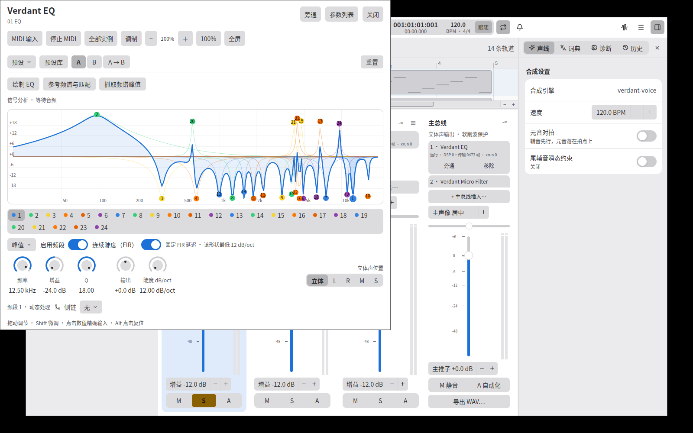
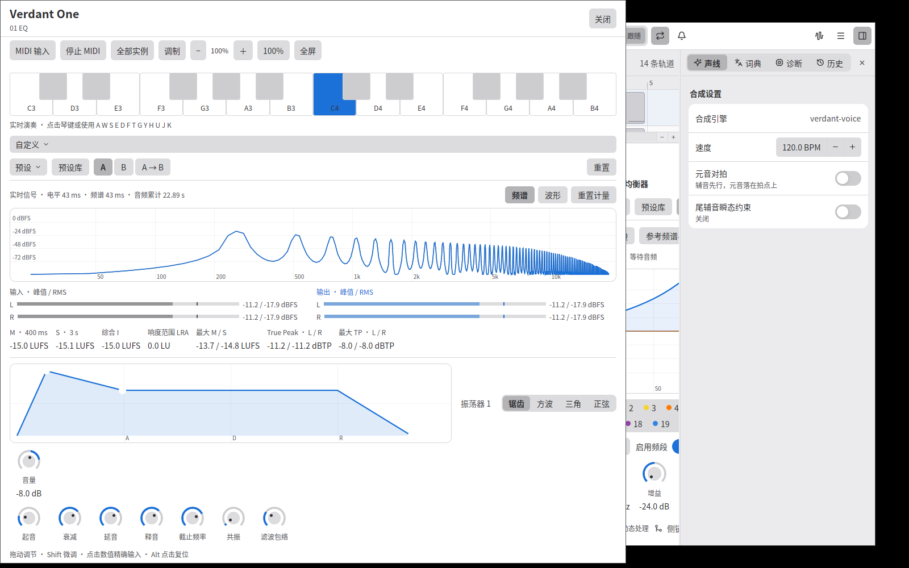
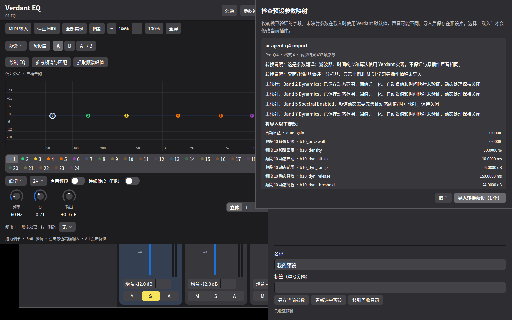
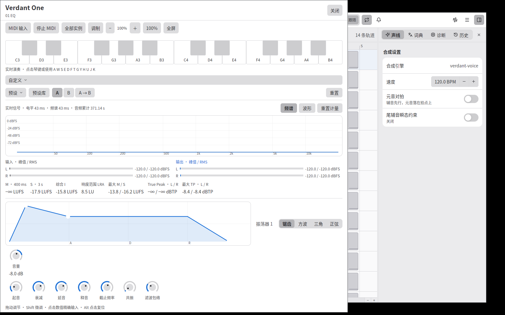

# 内置插件高级功能验收 · 2026-11-22

本回执记录 PR [#4](https://github.com/OpenGreendam/verdant/pull/4) 的实际运行结果。最终运行源码为 `2486f1e67c9bc0e01f4b5d8931a360264d967f84`；完整高级 DSP 与公开 CLI 导出来自 `07ae7c8dd5db1862cc455474ed4178074252137e`。随后仅修复原生乐器演奏键重复事件的界面刷新，导出所用 CLI、worker 和 plughost 的二进制 SHA-256 已核对保持相同。回执提交本身只增加证据。

完整能力与限制见 [NATIVE-PLUGIN-SUITE.md](../../NATIVE-PLUGIN-SUITE.md)，机器可读记录见 [acceptance.json](acceptance.json)。CI 必须查看 PR 最终 head 的检查状态；本地回执不预写尚未完成的云端检查。

## 交付范围

12 个效果器（EQ、Compressor、Gate、De-esser、Limiter、Reverb、Delay、Saturation、Multiband、Filter、Dual Filter、Micro Filter）及 Synth、One 两个乐器均有默认原生 GPUI 编辑器，统一使用 Adwaita 风格。14 台设备合计 3,542 个参数，包括每台 164 个共享调制／MIDI 参数。清单、控制路径参数及默认 DSP 延迟见 [inventory.json](inventory.json)。

新增功能包括 Spectral／FIR EQ、连续斜率、扩展动态风格和检测、重建峰值／连续 LUFS／dither、FDN 混响与 IR 参数拟合、16 抽头延迟、六段饱和与动态、四滤波器路由、原生实时 MIDI／MPE 合成、8 路调制矩阵、16 步 XLFO、MIDI Learn，以及持久化 A/B、用户预设与收藏、预设翻译预览、实例浏览器、缩放／全屏和实时音频图形。

## 自动化检查

| 检查 | 观察到的结果 |
|---|---|
| 完整 workspace 构建 | 成功；固定 Cargo.lock，protocol-fixture 特性 |
| 最终 workspace 测试 | **1056 passed / 0 failed / 15 ignored**，107 个测试目标 |
| 真实宿主子进程补充测试 | **5 passed**：真实 PCM、MIDI／响度／复位、Limiter 暂停与复位、精确节拍、正常回收与崩溃区分 |
| 服务层补充测试 | **2 passed**：CLAP 乐器真实出声；旧实例 ID、物理插入槽、轨道／主总线侧链和节拍 |
| 官方预设语料 | **1 passed**，1,769 文件；23 完整参数翻译、437 带诊断的部分翻译、1,309 仅识别；0 解析失败 |
| Proto GPUI 规则 | 5 个规则案例通过 |
| Proto 上游重生成 | 固定上游 checkout 不在本环境，按现有门禁以 exit 10 跳过；保留的生成制品仍受规则检查 |

8 个补充测试来自 workspace 中显式忽略的真实进程／外部语料项目；未执行的其他忽略项不写成已通过。测试目标摘要和补充输出见 [test-results.txt](test-results.txt)，原始日志指纹保存在 JSON 回执。语料中的“完整”只描述已检查参数字段，不证明原厂声音等价；原厂预设文件不随仓库分发。

覆盖实际音频的宿主测试还验证：参数整批原子拒绝、采样偏移、旧状态默认值、连续调制期间的任意分块逐样本一致，以及处理已准入音频／事件时 **0 次堆分配和 0 次释放**。这些结论只覆盖对应测试路径，不等于所有硬件的硬实时保证。

## 完整工程公开 CLI 导出

输入：[native-suite-advanced.verp](../../../../spec/examples/native-suite-advanced.verp)。工程包含 14 条轨、每轨 8 个音符、12 种效果器、2 种乐器、4 处侧链、轨道及主总线处理，以及 120／90／150 BPM 变化。非默认参数在写入工程前逐项按照真实描述符检查范围与步长，详见 [fixture-manifest.json](fixture-manifest.json)。

导出由 `verdant-cli render` 调用实际 worker 与 plughost 完成，包含效果和有界尾音。Debug 构建用时 349.15 秒；这是集成正确性检查，不作为实时性能基准。

| 输出 | 实测 |
|---|---:|
| 格式 | IEEE Float32，48 kHz，立体声 |
| 帧数 | 1,151,200 |
| 时长 | 23.98333333 秒 |
| 文件大小 | 9,209,656 bytes |
| 非有限样本 | 0 |
| 样本峰值 | 0.2680390179 |
| RMS | 0.0221879553 |

WAV SHA-256：`44c0947ac98d9ec8f078adbe4c097026b79421ca4ff6bd0f344e0b2602b569ac`。

[导出报告](export-report.json)保留了实际渲染指纹与处理实例，制品路径改为文件名；[独立 RIFF／PCM 检查](export-validation.json)记录帧数、有限值、峰值与 RMS。完整 WAV 留作运行证据，不作为大二进制加入源码。上述 SHA 记录本次实际输出，不声明不同 CPU／系统的浮点结果必然逐位相同。

## FIR 调制预算

修复前，连续 FIR 参数写入会在同一控制 tick 多次同步重建。现在 EQ 与 Multiband 使用预分配设计缓冲和固定 32 帧时钟分阶段工作，完成后在 128 帧卷积边界发布；连续写入不会不断取消工作，历史与既定延迟保留。静态初始化及固定相位／分辨率切换仍同步完成。

Release 基准通过公开 DSP API，48 kHz、32 帧、1,500 ticks，含参数写入和音频处理，排除初始化：

| 场景 | Median | P95 | Max | RTF |
|---|---:|---:|---:|---:|
| 24 段连续斜率、高分辨率、每 tick 8 次写入 | 0.126 ms | 0.521 ms | 1.239 ms | 0.246 |
| 六段线性 Multiband、每 tick 8 次写入 | 0.152 ms | 0.421 ms | 0.650 ms | 0.296 |

原始数值：[1,500 ticks](fir-budget-1500.json)、[1,200 ticks 复跑](fir-budget-1200.json)。32 帧时限约 0.667 ms；最大墙钟时间包含系统调度抖动，不能据 RTF < 1 宣称硬实时。EQ／Multiband 最新目标更新窗口及不可调制的固定控制见能力文档。

## 实际桌面交互

环境：Debian 13、Rust 1.98.1、GPUI、独立 Xvfb／Openbox／Mesa lavapipe、静音音频输出。FFT、响度和计量来自输出前捕获的实际合成／处理 PCM。没有使用动画模拟信号。

| 操作 | 已观察行为 |
|---|---|
| 全部 14 类默认原生窗口 | 逐一打开；同实例窗口复用；参数列表可切换；轨道／主总线入口有效 |
| Adwaita 主题和布局 | 浅色／深色、100%／150%／200% 缩放、全屏、400×300 窄窗口滚动 |
| 图形／调制 | 节点拖动、单位输入、来源条拖入参数、XY 双轴提交、频谱峰值抓取、跨实例匹配 |
| A/B | 旧快照补齐新参数；整批确认；切换固定 FIR 模式重建后恢复；关窗重开仍正确 |
| 用户预设 | 名称／标签／收藏／筛选／更新；原生文件对话框导出、回收、重新导入；收藏及标签保留 |
| FFP | 查看映射与未支持字段；明确选择部分转换；载入已转换预设，连续斜率路径生效 |
| 乐器 | 鼠标与电脑键盘演奏、实际频谱和 LUFS、参数改变、计量复位、松键和失焦释放 |
| 键盘自动重复 | 对照发现 X11 重复事件会饿死绘制；修复后在默认 repeat 开启时持续演奏并观察计时／计量更新 |
| 工程与导出 | 参数、MIDI 表达、侧链、节拍变更保存；同一公开 CLI 完成高级工程导出 |

Linux Vulkan 窗口的 `import -window` 曾读到陈旧 backing pixmap，因此动态交互证据改用整个 Xvfb 根窗口捕获。截图只证明相应时刻的显示，持续行为以实际顺序操作及代码／音频回归为依据。

### Adwaita 浅色 EQ 与 A/B 恢复

高级套件最终构建中，旧 A/B 快照补齐新增参数，经过固定 FIR 路径重建、切换和关闭重开后恢复。图中为验收用极端频段设置。



### One 持续演奏：11.33 秒

键盘自动重复开启，A 持续按下，C4 高亮；音频累计 11.33 秒、综合响度约 −15.0 LUFS。


### One 持续演奏：22.89 秒

同次长按继续保持，音频累计推进至 22.89 秒，曲线和电平继续刷新，综合响度保持有限值。



### Adwaita 深色预设映射预览

高级功能交互验收阶段的实际截图。导入前展示已转换参数及未映射的动态字段，由用户明确选择部分转换；不把格式识别当作完全兼容。



### One 松键后正确停音

Fresh keydown→keyup 序列中，音频累计 371.14 秒，C4 已取消高亮；峰值和 RMS 回落至 −120 dBFS，综合响度保留已累计的测量。另一次失焦／返回也确认正确释放。



## 需保留的能力边界

- 当前内部效果宿主为 **48 kHz／立体声**；环绕声、Dolby Atmos 多通道／对象宿主尚未实现。
- 功能属于独立实现；不声明专有 DSP、原厂所有风格、音色或参数响应完全等价。
- `.ffp` 只翻译文档列明且验证过的字段；其他多数二进制仅识别，不能直接载入。
- IR 导入是混响参数拟合；EQ Match／Sketch 是有限 Bell 拟合。计量没有第三方认证。
- 进程效果桥仍有 **9,472 帧**基础传输缓冲；这份回执不宣称低延迟监听。
- 自动化和 MIDI Learn 不接纳会改变延迟或容量的固定控制。共享乐器调制为全局路径；逐声部 MPE 表达另行处理。
- Windows／macOS CI 证明其规定的原生构建、测试与打包；物理声卡／MIDI、这些平台的 GUI 操作、IME 和屏幕阅读器未在本回执中验收。

## 复现

在仓库根目录，先按照 [构建说明](../../../README.md)安装依赖：

```sh
cd frontend
cargo build --offline --locked --workspace --features verdant-test-worker/protocol-fixture
export VERDANT_WORKER_BINARY="$PWD/target/debug/verdant-worker"
export VERDANT_TEST_WORKER_BINARY="$PWD/target/debug/verdant-test-worker"
export VERDANT_PLUGIN_HOST="$PWD/target/debug/verdant-plughost"
cargo test --offline --locked --workspace --features verdant-test-worker/protocol-fixture
cargo test --offline --locked -p verdant-plugins --test builtin_signal -- --ignored --nocapture
cargo test --offline --locked -p verdant-service project_audio::tempo_tests -- --ignored --nocapture
cargo run --offline --release -p verdant-plugins --no-default-features --example native_fir_budget -- --ticks 1500 --frames 32 --json /tmp/native-fir-budget.json
```

若设置独立 `CARGO_TARGET_DIR`，对应二进制路径也应指向该目录。官方语料检查需要合法取得的本地语料；CLAP 服务层额外测试需要构建测试插件 fixture。

公开 CLI 导出参数示例（将两个可执行文件路径改为本地构建位置）：

```json
{"workspace":"/tmp/verdant-suite-acceptance","worker":"/absolute/path/verdant-worker","plughost":"/absolute/path/verdant-plughost","sample_rate":48000,"channels":2,"encoding":"Float32","scope":"Mix","effects":true,"overwrite":true,"max_duration_seconds":60}
```

```sh
target/debug/verdant-cli render ../spec/examples/native-suite-advanced.verp --output /tmp/native-suite-advanced.wav --report /tmp/native-suite-export.json --params /tmp/verdant-render-params.json --json
```
